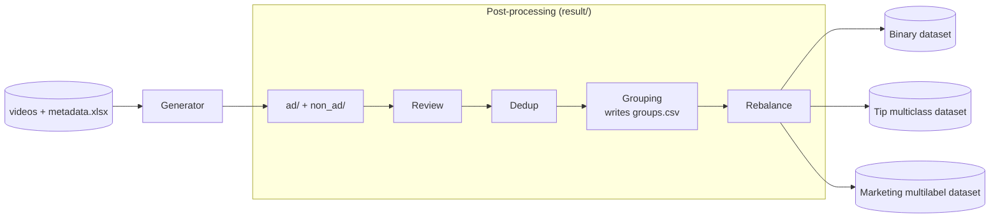

# Unhealthy Dataset Generator

Builds image datasets of junk-food TV ads from recorded videos and a `metadata.xlsx` ad log:

- **Binary**: `ad` vs `non_ad` frames (one frame per second).
- **Tip multiclass**: one class per ad type (`tip`), plus a non-ad class `0`.
- **Marketing multilabel**: ad frames labelled with the `rpr`–`rie` strategy columns.

It also includes tools to review, de-duplicate, group (to prevent train/test leakage) and rebalance the frames.

## Setup

1. Create and activate a virtual environment:

   ```
   python -m venv unhealthy-dataset-generator-env
   unhealthy-dataset-generator-env\Scripts\activate.bat          # Windows
   source ./unhealthy-dataset-generator-env/bin/activate         # macOS/Linux
   ```

2. Install Tesseract OCR (used to read the on-screen clock). Check it with `tesseract --version`.
   - Windows: [UB Mannheim build](https://github.com/UB-Mannheim/tesseract/wiki), and add its folder to `PATH`. If it is not in `C:\Program Files\Tesseract-OCR`, set `TESSDATA_PREFIX` to its `tessdata` folder.
   - macOS: `brew install tesseract`
   - Linux: `sudo apt install tesseract-ocr libtesseract-dev libleptonica-dev`

3. Install Python dependencies:

   ```
   pip install -r requirements.txt
   ```

   - Windows: `tesserocr` has no PyPI wheel. First install the one matching your Python from [tesserocr-windows_build](https://github.com/simonflueckiger/tesserocr-windows_build/releases), e.g. for Python 3.14:
     ```
     pip install https://github.com/simonflueckiger/tesserocr-windows_build/releases/download/tesserocr-v2.10.0-tesseract-5.5.2/tesserocr-2.10.0-cp314-cp314-win_amd64.whl
     ```
   - GPU (optional, for CLIP in dedup/grouping): install the CUDA build of `torch` first, e.g. `pip install torch --index-url https://download.pytorch.org/whl/cu124`.
   - Dedup downloads the CLIP model (`clip-ViT-B-32`) and grouping downloads DINOv2 (`facebook/dinov2-base`, cached in `./models`, gitignored) on first run, so they need internet the first time.

4. Copy `default_config.json` to `config.json` and set `path.videos`, `path.dataset` and one `videos_metadata` entry per video (see [Config](#config)).

## Architecture



**Data leakage:** the same commercial airs many times, so near-identical frames could end up in both train and test. Grouping gives every frame a `group` (one per ad creative, one per non-ad channel). Split all datasets by `group` (both the multiclass and multilabel CSVs carry a `group` column).

## Usage

Run every command from the repo root. Each script reads `config.json` (falls back to `default_config.json`).


| Step | Command | What it does |
| --- | --- | --- |
| 1. Generate | `python src/dataset_generator_pipeline/main.py` | Builds `result/ad/` and `result/non_ad/`. **Wipes `result/` first.** |
| 2. Review | `python src/misc/review_dataset.py` | GUI to discard bad frames into `result/discarded/`. |
| 3. Dedup | `python src/duplicate_images_removal_pipeline/image_similarity.py` | Moves near-duplicate frames to `result/duplicates/`. |
| 4. Group | `python src/grouping_pipeline/group_frames.py` | Assigns leakage groups and caps frames per ad creative. |
| 5. Rebalance | `python src/rebalance_pipeline/rebalance.py` | Trims the over-represented class to `rebalance.target_ratio`. |
| 6. Multiclass | `python -m src.tip_multiclass_dataset_generator.main` | Builds the tip multiclass dataset. |
| 7. Multilabel | `python -m src.marketing_strategies_multilabel_dataset_generator.main` | Builds the marketing multilabel dataset. |
| 8. Zip | `python src/misc/make_zips.py` | Packs `binary-dataset.zip`, `tip-multiclass-dataset.zip` and `multi-strategies-dataset.zip` (with augmented train sets if present) at the repo root. |

Steps 2–7 are optional, but keep this order (e.g. multiclass needs `groups.csv` from step 4). Steps 2–5 move frames into subfolders of `result/` instead of deleting them. Steps 3–5 accept `--dry-run`.

### Generator

For each `metadata.xlsx` row (first sheet) whose `tip` is in `tip_values`, it extracts one frame per second of the ad. It reads the burned-in clock with OCR to drop frames outside the ad window. Then it samples `non_ad` frames away from any ad.

Output names (other scripts parse these):
- Ad: `{video}_{cod}_{counter}.jpg`. `cod` must be 5 digits, or later steps skip the frame.
- Non-ad: `{date}_{channel}_non_ad_{counter}.jpg`.

### Review GUI

Browses ad frames by ad and non-ad frames by page. Keys: `A` select all, `D` discard and advance, `H`/`L` or arrows to navigate, `Ctrl+Z` undo.

### Dedup

```
python src/duplicate_images_removal_pipeline/image_similarity.py [folder] [--dry-run] [--combined-threshold N] [--clip-weight N] [--hash-size N] [--batch-size N] [--chunk-size N]
```

Compares frames with CLIP + a perceptual hash and keeps one per similar group. Writes `duplicates_manifest.csv`.

### Grouping (data leakage prevention)

Gives every frame a `group` (see [Data leakage](#architecture)). Split with e.g. scikit-learn's `GroupShuffleSplit` or `StratifiedGroupKFold`.

```
python src/grouping_pipeline/group_frames.py [result] [--dry-run] [--max-frames N] [--centroid-threshold N] [--frame-threshold N] [--non-ad-group-by {channel,video}] [--batch-size N]
```

- Ad frames: grouped by the normalized metadata `nom`. Creatives that look alike under DINOv2 are merged (typos, alternate cuts, and spots of the same brand that reuse shots or templates).
- Non-ad frames: one group per channel (or per source video with `--non-ad-group-by video`).
- Ad groups above `max_frames_per_creative` are trimmed evenly; extras go to `result/capped/ad/`.

Writes `result/groups.csv` (`image_name`, `label`, `group`, `creative`, `capped`). Safe to re-run.

### Rebalance

```
python src/rebalance_pipeline/rebalance.py [result] [--dry-run] [--target-ratio N] [--excess-dir DIR]
```

Trims whichever class is above `target_ratio`, moving extras to `result/excess/` and keeping survivors evenly spread across the sorted file list.

### Tip multiclass dataset

```
python -m src.tip_multiclass_dataset_generator.main [binary_root] [--output DIR] [--non-ad-ratio N]
python -m src.tip_multiclass_dataset_generator.check_dataset [multiclass_root]
```

- Class = number before `=` in `tip` (`"2=..."` → `2`). Only `tip_values` are kept.
- Class `0` = non-ad frames, sized `multiclass.non_ad_ratio` × the largest ad class. `--non-ad-ratio 0` disables it.
- Output: `images/` (copies, wiped each run) and `tip_multiclass_dataset.csv` (`image_name`, `tip`, `tip_label`, `group`, `split`).
- `group` comes from `result/groups.csv`, so run the grouping step first.
- `split` (`train`/`val`/`test`, 70/15/15 by whole groups) uses the same algorithm and seed as the training notebooks (`split.py`; keep both in sync).
- The checker prints the class distribution per split and fails on missing groups, groups in several splits, or a bad augmented set.

#### Train-only augmentation (optional)

```
python -m src.tip_multiclass_dataset_generator.augment [multiclass_root] [--dry-run] [--target-ratio N] [--max-multiplier N] [--seed N]
```

- Tops up each class in **train** to `target_ratio` × the largest train class, capped at `max_multiplier` × its original train frames. Val and test are never augmented.
- Transforms: random crop (80–100% area), ±5° rotation, ±3% shift, brightness/contrast/saturation jitter, tiny hue shift, optional blur/noise, JPEG re-encode. No flips (logos and text).
- Output: `augmented/` (wiped each run) and `tip_multiclass_augmented.csv` (main CSV columns + `source_image`). The main CSV and `images/` are untouched.
- Training: split with the `split` column and append the augmented rows to train only.

### Marketing multilabel dataset

```
python -m src.marketing_strategies_multilabel_dataset_generator.main [binary_root] [--output DIR]
python -m src.marketing_strategies_multilabel_dataset_generator.check_dataset [multilabel_root]
python -m src.marketing_strategies_multilabel_dataset_generator.augment [multilabel_root] [--dry-run] [--min-train-share N] [--target-train-share N] [--max-multiplier N] [--seed N]
```

Joins each ad frame's `cod` with `metadata.xlsx` (sheet `Base combinada`, or the first sheet). Output: `images/` (copies, wiped each run) and `marketing_multilabel_dataset.csv` (`image_name` + columns `rpr` through `rie` + `group` + `split`).

- `split`: whole groups assigned to train/val/test (70/15/15), balancing each label's positives across splits (`split.py`). Labels with fewer than 3 groups can't reach every split.
- `augment` (optional, train only): runs only if the real train share is below `min_train_share`, then adds augmented copies until train is `target_train_share`. Sources are drawn favouring rare labels, at most `max_multiplier` uses each. Writes `augmented/` + `marketing_multilabel_augmented.csv` (main columns + `source_image`).
- The checker fails on missing groups, groups in several splits, or a bad augmented set.

- `group` comes from `result/groups.csv`, so run the grouping step first.
- The checker fails on a missing `group` column or empty groups.

For both dataset generators, pass the binary dataset root (not `result/`). The binary dataset is never modified. Grouping and both generators read the `Base combinada` sheet if it exists, otherwise the first sheet.

### Crop tuning

```
python src/misc/test_custom_crop_params.py --video_path <path> --top N --bottom N --left N --right N
```

Shows a cropped frame and prints a `"crop": {...}` snippet to paste into `videos_metadata`.

## Config

See `default_config.json`. The generator requires every key in it to exist in `config.json` with the same type.

- `path.videos`: folder with the `.mp4` recordings.
- `path.dataset`: binary dataset root (with `metadata.xlsx`). `path.multiclass_dataset` / `path.multilabel_dataset`: output folders.
- `tip_values`: `tip` numbers to include (e.g. `[2, ..., 8]` skips `1=`).
- `non_ad_ratio`: non-ad frames per ad frame in the binary dataset.
- `non_ad_gap_seconds`: seconds around each ad excluded from non-ad sampling.
- `tv_channels_mapping`: first digit of `can` → channel in the video name (`"1": "DN"` → `{date}_DN_processed.mp4`).
- `videos_metadata.<file>`: `start_time` (`HH:MM:SS`, when the recording starts) and optional `crop` (`top`/`bottom`/`left`/`right` px).
- `duplicate_images_removal`: `combined_threshold`, `clip_weight` (0–1, CLIP vs hash), `hash_size`, `batch_size`, `chunk_size`.
- `grouping`: `max_frames_per_creative` (`0` = no cap), `model` / `model_cache_dir` (DINOv2 model and its local cache), `centroid_threshold` (mean-embedding cosine that merges two creatives), `frame_threshold` + `frame_match_min_centroid` (merge when the best frame match and the mean-embedding cosine both clear these), `non_ad_group_by` (`channel` or `video`), `batch_size`.
- `rebalance.target_ratio`: desired `non_ad : ad` ratio.
- `multiclass.non_ad_ratio`: size of class `0` relative to the largest ad class.
- `multiclass.augmentation`: `target_ratio` (train target per class relative to the largest train class), `max_multiplier` (cap per class vs its original train frames), `seed`.

`metadata.xlsx` columns used: `cod` (row id), `tip` (ad type), `can` (channel), `fec` (date), `hin`/`hfi` (ad start/end), `nom` (ad name, for grouping), `rpr`–`rie` (multilabel labels). To test one video, filter the sheet to its `can` and `fec`.

## Directory layout

```
{path.dataset}/
  metadata.xlsx
  result/                      # wiped by the generator
    ad/  non_ad/
    discarded/{ad,non_ad}/     # review
    duplicates/                # dedup (+ duplicates_manifest.csv)
    capped/ad/  groups.csv     # grouping (+ capped_manifest.csv)
    excess/                    # rebalance (+ rebalance_manifest.csv)
{path.multiclass_dataset}/
  images/  tip_multiclass_dataset.csv
  augmented/  tip_multiclass_augmented.csv   # optional, train only
{path.multilabel_dataset}/
  images/  marketing_multilabel_dataset.csv
  augmented/  marketing_multilabel_augmented.csv   # optional, train only
{path.videos}/
  YYYY-MM-DD_{channel}_processed.mp4
```
